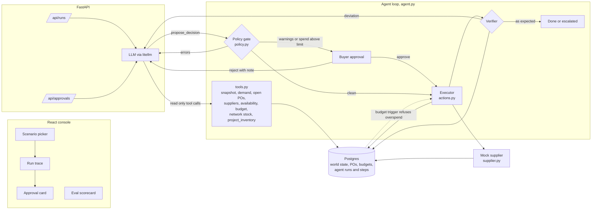
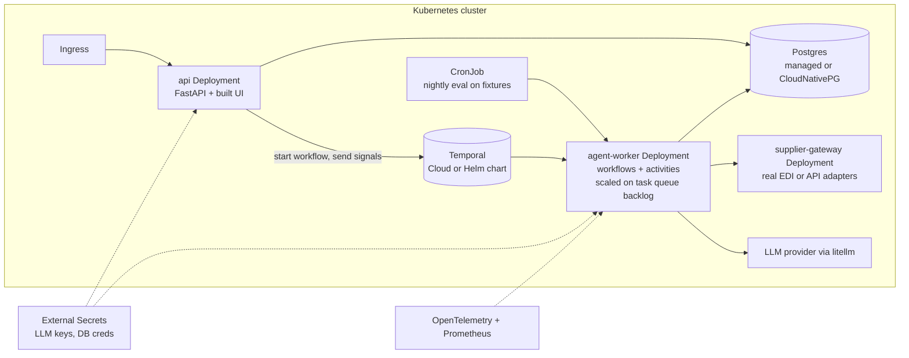

# AI Purchasing Agent

An agent that takes a purchasing situation (a replenishment recommendation, a supplier that can only ship part of an order, a demand shift, a constraint), investigates it through read only tools, proposes a decision, and then lets code take over: a deterministic policy gate validates the proposal, a buyer approves it when the rules say so, an executor writes it to Postgres and the mock supplier, and a verifier reads the world back to check that it ended up where the plan said. When it did not (the supplier confirmed less, the database refused the order), the difference goes back to the agent as an observation and it re-plans.

The model reasons. Code decides what is allowed, does the writing, and checks the result.

## Results

Twelve scenarios covering all four in the brief, each graded on the final database state against an answer key worked out by hand. Model `gemini/gemini-3.5-flash` through litellm, one run per scenario, a simulated buyer approving anything sent for approval.

| | decision | evidence | constraints | action | validated | recovery | all six |
| --- | --- | --- | --- | --- | --- | --- | --- |
| **Agent** | 12/12 | 12/12 | 12/12 | 12/12 | 12/12 | 12/12 | **12/12** |
| Naive baseline (blind execution) | 4/12 | 0/12 | 6/12 | 3/12 | 0/12 | n/a | 0/12 |

Two runs put the feedback loop under real load:

- **`s2_recovery_stale_quote`**: the replacement supplier's portal quoted 1000 units, it confirmed 72 of the 228 ordered. The verifier caught it, the agent closed that PO short at 72 and ordered the remaining 156 from a third supplier, and the gate sent that order to a buyer because of its 17.5 percent price premium.
- **`s4_budget_race`**: another buyer spent the budget between the agent's check and its write. The Postgres trigger refused the PO, the refusal came back to the agent as an observation, and it escalated rather than look for a way around the budget.

The eval also caught two of my bugs on the way, which is what it is for: the verifier disagreed with the policy gate about investigations (now one shared rule, with a regression test that fails on the old code), and the grader checked MOQ on a PO the supplier had short confirmed instead of on what the agent ordered. Full scorecards: [agent](eval/results/latest.md), [baseline](eval/results/naive.md). The full suite takes about 9 minutes and 520k tokens.

One run per scenario is a small sample for a stochastic system; `--repeat N` reports pass rates over repeated runs.

## Run it

You need an LLM key for any provider [litellm](https://docs.litellm.ai/docs/providers) supports. Claude is the default.

```bash
cp .env.example .env          # put your ANTHROPIC_API_KEY (or another provider) in it
docker compose up --build     # Postgres + API + UI on http://localhost:8000
```

Local development without Docker for the app:

```bash
docker compose up -d db                       # or any Postgres 14+, then set DATABASE_URL
uv sync
uv run uvicorn buyer.api:app --reload         # API on :8000
cd web && npm install && npm run dev          # UI on :5173, proxies /api to :8000
```

Tests and eval:

```bash
uv run pytest                                    # policy gate, executor, verifier (no LLM needed)
uv run python -m buyer.evaluate                  # every scenario through the real agent
uv run python -m buyer.evaluate --mode naive     # blind execution baseline, same grader
uv run python -m buyer.evaluate --only s2_recovery_stale_quote --repeat 3
```

In the UI: pick a scenario on the left (it resets Postgres to that scenario's world), press **Run agent**, and watch the trace: tool calls, the proposal, the policy gate's verdict, the approval card when one is needed, execution, verification and any re-plan. The **Eval** tab shows the latest scorecards for the agent and for the naive baseline.

## Architecture



| Piece | File | Job |
| --- | --- | --- |
| Schema | `backend/buyer/schema.sql` | Nodes, products, inventory, sales, forecast, signals, suppliers, POs, transfers, budgets, tasks, agent runs and steps. A `BEFORE` trigger enforces the budget on every PO write under a row lock. |
| Projection | `backend/buyer/domain.py` | Day by day stock projection shared by the agent's what if tool, the policy gate, the verifier and the grader, so the agent is judged on the same numbers it saw. |
| Tools | `backend/buyer/tools.py` | Eight read only tools. The model has no write tool at all. |
| Policy gate | `backend/buyer/policy.py` | Deterministic checks on a proposal. Errors go back to the model; warnings route to a buyer. |
| Executor and verifier | `backend/buyer/actions.py` | Applies actions, submits POs to the supplier, then re-reads the database and re-projects to compare with the plan. |
| Mock supplier | `backend/buyer/supplier.py` | Quotes from a portal that can be stale; confirms what it can really ship. Also exposed at `/supplier/...`. |
| Agent loop | `backend/buyer/agent.py` | Turn loop, proposal handling, approval pause and resume, recovery loop, budgets on turns, rejections and recoveries. |
| Scenarios | `backend/scenarios/*.json` | Twelve self contained worlds, each with a hand computed answer key. |
| Eval | `backend/buyer/evaluate.py` | Runs scenarios end to end and grades the final database state. |

## Approach

**Breaking the problem down.** A buyer's decision is three questions: what will happen if I do nothing, what can I do about it, and what am I allowed to do. The first is arithmetic over stock, demand and inbound supply, so it is code (`project_inventory`), not model output. The second needs judgement: is this sales spike real, is this stock record trustworthy, is the cheaper supplier worth its slower lead time, should stock move between stores. That is where the model earns its place. The third is policy, so it is code again (`policy.py`) and the database (`enforce_budget`).

**What the agent can see.** Stock and storage capacity, the last cycle count, 28 days of sales against forecast, promotions and weather signals, open POs with supplier messages, inbound transfers, supplier terms (price, MOQ, case pack, lead time, fill rate), live availability from the supplier portal, budget (committed, remaining, reset date), and transferable surplus at other stores.

**What the agent can do.** It can only propose. A proposal is a verdict (accept, modify, reject, investigate, escalate) plus actions from a closed set: `create_po`, `amend_po` (reduce only), `cancel_po`, `transfer`, `request_cycle_count`, `escalate`. Writes happen in the executor, after the gate, under database constraints.

**Coverage rule.** A plan must keep the store stocked from the first day any new supply could arrive (fastest supplier lead time) through the coverage horizon (that lead time plus the review period). Stockouts before the first possible arrival are not the plan's fault, so they are not counted against it.

**When a human is in the loop.** The gate sends executable plans to a buyer when any warning fires (supplier price more than 15 percent above reference, overstock beyond the cap, expected shelf life waste, demand basis far above both forecast and recent sales, a suspect stock record, cancelling a confirmed PO, a coverage gap that is being escalated) or when spend is above `AUTO_APPROVE_LIMIT`. A rejection with a note goes back to the agent as feedback. Escalations and cycle counts become tasks for people.

**Reliability.** Every run is bounded (30 model turns, 3 rejected proposals, 2 recoveries); when a bound is hit the run ends escalated, never silently. Every step is persisted in `agent_steps`, so a run can pause for approval and resume in another process. The approval update is guarded on `status = 'pending'`, so a double click executes once. A crash ends the run as `failed` with the error recorded.

## How decisions are validated

Validation happens three times, at three different layers, on purpose.

1. **Before execution, the policy gate** (`policy.py`). It recomputes everything the model claimed: evidence (did it call the tools this kind of action depends on), MOQ and case pack, supplier active, transfer source keeps its own target, budget remaining, storage peak against capacity, coverage through the horizon, overstock and shelf life waste, demand basis sanity, stock record quality, and whether the model's own `expected.cover_days` and `expected.spend` match the projection. A mismatch there is treated as a hallucination and returned as an error.
2. **At the write, Postgres.** CHECK constraints on quantities and statuses, and the `enforce_budget` trigger, which locks the budget row and refuses any PO that would overspend. This catches what the gate cannot see: another buyer committing spend between the agent's check and its write (`s4_budget_race`). The refusal is returned to the agent as an observation, not raised as a crash.
3. **After execution, the verifier** (`actions.py: verify`). It reads every PO, transfer and task back, compares confirmed quantities with ordered quantities, re-projects the item from the database and compares actual cover with the cover the gate predicted, and checks capacity and budget again. Any difference is a deviation.

**The feedback loop.** A deviation is sent back to the model as the result of its `propose_decision` call, with the current projection and an instruction to propose only the additional actions needed. The model can investigate again (for example, re-check other suppliers' availability) and propose a recovery, which goes through the same gate, approval and verification. After two recoveries, or when no recovery is possible, the run ends escalated with a task for a buyer. `s2_recovery_stale_quote` exercises this: the cheap supplier's portal quotes 1000 units, it really has 72, and the first PO comes back short.

## Scenarios

Each fixture in `backend/scenarios/` is a full world (nodes, products, stock, 28 days of sales, suppliers, budget, POs, signals) plus a situation and an `expect` block. The `notes` field in each one shows the hand arithmetic behind the expected answer.

| Scenario | What is going on | Expected |
| --- | --- | --- |
| `s1_modify_open_po` | Recommendation of 800 ignores an open PO of 400; 800 would break storage and budget. | Modify to one MOQ (240 to 480), mention PO-1001. |
| `s1_accept_recommendation` | Recommendation is within 3 percent of the order up to quantity. | Accept, about 800 from ANDINA. |
| `s1_reject_overstock` | Stock plus open PO already covers 41 days. | Reject, buy nothing. |
| `s1_investigate_phantom` | Record says 310 on hand, but zero sales for 6 days and no count for 46 days. | Investigate: cycle count, no big order. |
| `s2_shortfall_transfer` | Supplier ships 250 of 500; another store has 440 spare. | Close the remainder; transfer or buy about 220 from the alternate supplier. |
| `s2_shortfall_sufficient` | Supplier ships 250 of 500, but stock still covers 21 days. | Accept the partial fill, source nothing. |
| `s2_recovery_stale_quote` | Replacement supplier's portal overstates stock; first PO comes back short. | Detect it, re-plan to a third supplier or escalate. |
| `s3_demand_spike` | Sales 2.5x forecast for a week during a heat wave advisory. | Raise the demand basis, buy about 620 more. |
| `s3_spike_promo_ended` | Sales 2.9x forecast, but it was a 2 for 1 promotion that ended yesterday. | Keep the plan, buy nothing. |
| `s4_budget_cap` | The right quantity costs 1740; 900 of budget is left until the period resets. | Buy what fits (ANDINA, at most 900) and escalate the gap. |
| `s4_moq_perishable` | Recommended supplier's MOQ is 20 days of a yogurt with an 8 day shelf life. | Buy 48 to 96 from the local dairy at a premium; buyer approves. |
| `s4_budget_race` | Another buyer spends the budget between the agent's check and its write. | Trigger refuses the PO; agent re-plans and never breaches budget. |

## Evaluation approach

The grader (`evaluate.py`) runs a scenario end to end, with a simulated buyer approving anything sent for approval, and then grades the **final database state**, not the agent's own account of what it did. Six checks per run map to the questions in the brief:

| Check | Question | How it is graded |
| --- | --- | --- |
| decision | Was the decision correct? | Verdict is in the fixture's accepted set. |
| evidence | Did it get the information it needed? | The fixture's required tools were all called. |
| constraints | Did it respect the constraints? | Budget lines not overrun, storage peak within capacity at the true demand, every agent PO on MOQ and case pack, no expected expiry, spend cap where set. |
| action | Did it take the right action? | Required action types taken, forbidden ones not, suppliers and quantities inside the band, final cover at the scenario's true demand between the minimum and the overstock cap, approval asked exactly when it should be, key facts mentioned. |
| validated | Did it validate the result? | At least one verification ran and the run ended in a terminal state. |
| recovery | What happens when the first action fails? | If any verification found a deviation, the run must end either verified or escalated. |

**Checking the grader itself.** The same grader runs on a naive baseline that executes the upstream instruction blindly (buy the recommendation, reorder a shortfall from the same supplier, keep the plan on a demand change). It scores 0/12, and its failures are the right ones: the 800 cola order is refused by the budget trigger, the 800 shampoo order breaks case pack on a stock record nobody trusted, reordering a shortfall from the supplier that just ran out breaks its case pack, the 240 yogurt order would expire. Where blind execution happens to land on the right outcome (`s1_accept_recommendation`, `s3_spike_promo_ended`, and `s4_budget_race`, where the trigger stops the blind order) the grader gives credit on decision, constraints and action, and fails only evidence and verification. A grader that failed everything would prove nothing.

**Repeatability.** LLM runs vary. `--repeat N` runs each scenario N times and the scorecard reports per check pass rates, which is a better signal than one lucky run.

Latest results: [`eval/results/latest.md`](eval/results/latest.md) (agent) and [`eval/results/naive.md`](eval/results/naive.md) (baseline).

## Simplifications

- One SKU per PO, flat daily forecast, one world per scenario. Real POs have many lines and forecasts have shape.
- The supplier is in process. It sits behind the same two calls (`quote`, `submit`) it would have over HTTP, and those are exposed at `/supplier/{id}/quote` and `/supplier/orders/{po_id}/submit`.
- Runs execute in a background thread in the API process. That is the first thing the production path below replaces.
- No auth. The approval endpoint would sit behind the buyer's identity, and that identity would go on the approval row.

## Production path: Temporal and Kubernetes (planned, not in this repo)

This repo is the decision core. Running it against real stores needs durability and isolation that a thread in an API process does not give. The plan below is the next step; none of it is built here. It is the same shape as [Plnt](https://github.com/plnt-work/plnt), where workflows run as a Temporal saga on Kubernetes.

### Why Temporal fits this agent

The code is already split the way Temporal wants it. Everything nondeterministic or side effecting is a separate call (model turns, tool reads, executor writes, supplier submits), and everything that decides is plain code (the loop, the gate, the approval rule, the recovery budget). Moving to Temporal turns `agent.loop` into workflow code and wraps the other modules as activities. `tools.py`, `policy.py`, `actions.py` and `supplier.py` do not change.

| Today | With Temporal |
| --- | --- |
| `agent.run` in a daemon thread | `PurchasingDecisionWorkflow`, workflow id = situation id, so one situation can never run twice at once |
| `llm()` call with `num_retries=2` | `llm_turn` activity with a retry policy and timeouts; a provider outage pauses the run instead of failing it |
| Tool calls | `read_tool` activity, idempotent, retried freely |
| `execute` | One activity per action, idempotency key `run_id:action_index`, so a retry never places a second PO |
| `supplier.submit` returns at once | Supplier confirmation arrives later as a signal (`supplier_confirmed`), which is how real suppliers answer |
| Approval row plus polling | Workflow waits on a `buyer_decision` signal with a timer; no answer in N hours escalates on its own |
| "Executed actions stay executed, re-plan forward" | Explicit saga compensations per action type (cancel the PO, reverse the transfer) when a plan has to unwind |
| Nothing happens after the run ends | Durable timers: re-check on the PO's ETA that it actually arrived, and in `s4_budget_cap` place the deferred order on the day the budget resets |
| `agent_runs.state` jsonb | Workflow history; `agent_steps` stays as the buyer facing audit log |

### Target deployment



- **Workloads.** `api` (stateless, scaled on HPA), `agent-worker` (scaled on Temporal task queue backlog through KEDA), `supplier-gateway` as its own service so the supplier is a real network boundary with its own retries and rate limits. Packaged as one Helm chart with a values file per environment.
- **State.** Postgres stays the system of record, and the budget trigger keeps working unchanged because it lives in the database, not in the worker. Temporal holds run state.
- **Secrets and config.** LLM keys and DB credentials from External Secrets, never in images. `AUTO_APPROVE_LIMIT`, the price premium limit and the run budgets in a ConfigMap, so finance can tune them without a deploy.
- **Observability.** One trace per run (the `agent_steps` already map to spans). Metrics worth alerting on: gate rejection rate, deviation rate, approval wait time, escalation rate, tokens per decision, and supplier short confirmation rate by supplier.
- **Eval as a release gate.** The scenario eval runs in CI on every prompt, model or policy change and nightly as a CronJob. A drop in per check pass rate blocks the rollout, the same way a failing test does. New production incidents become new fixtures.

### Order of work

1. Temporal workflow and activities around the existing modules, with the supplier confirmation and buyer decision as signals.
2. Helm chart, worker autoscaling, secrets, traces.
3. Real integrations: ERP stock and PO sync, supplier adapters, buyer identity on approvals, multi line POs.
4. Shadow mode: the agent decides on live situations but only records; its decisions are compared with what buyers actually did before it is allowed to act.

## Other buyer problems the same design covers

The tools, gate and verifier are not specific to these four scenarios. Open PO hygiene (find POs past their ETA and chase or cancel them), supplier reliability (fill rate is already in the data and the stale quote case shows why it matters), safety stock tuning, and promotional pre-buys are each a new situation type plus a fixture and maybe one more read tool.
